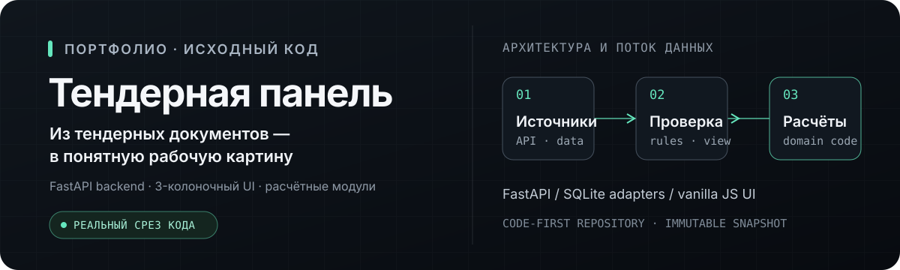
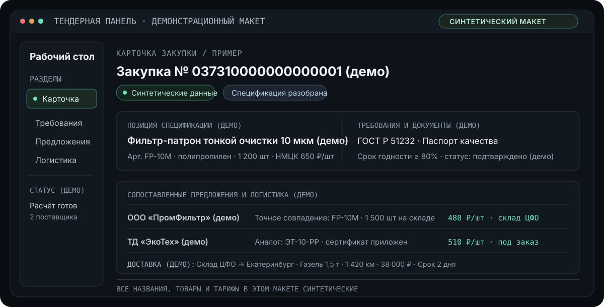

<p align="center">
  
</p>

# Тендерная панель

Из тендерных документов — в понятную рабочую картину.

Публичный срез **реального приложения** для портфолио: трёхколоночный интерфейс, backend на FastAPI, модули работы с требованиями, источниками предложений, логистикой и экономическими расчётами.

## Что показывает этот репозиторий

- **Интерфейс:** `index.html` и JavaScript/CSS-модули в `runtime/assets/` — карточки, поставщики, настройки поиска, логистический экран.
- **API и предметные модули:** `runtime/app/main.py` связывает FastAPI-маршруты с репозиториями и отдельными расчётными, логистическими и sourcing-модулями.
- **Доступ к данным:** SQLite-хранилища, read-model и проверки видимости отделены от интерфейса; исходные рабочие БД сюда не включены.
- **Служебный скрипт:** `scripts/build_osm_address_index.py` строит индекс из переданного локального набора адресных данных. Сам набор данных не распространяется.

Функциональные цепочки и связи на обложке — схема, а не измерение производительности или обещание результата.

## Иллюстрация интерфейса



**Важно:** изображение выше нарисовано для объяснения структуры интерфейса. Это не снимок запущенного приложения и не реальная карточка закупки; все подписи условные.

## Как читать код

```text
index.html
  └─ runtime/assets/          интерфейс, стили, sourcing и логистический экран
      └─ /api/*                запросы к backend
          └─ runtime/app/main.py
              ├─ repository.py / visibility.py   чтение и проекция данных
              ├─ sourcing_*.py                   поиск и обработка предложений
              ├─ logistics_*.py                  маршруты и расчёты доставки
              └─ economics.py / preliminary_earnings.py
                                                  расчётные правила
```

Начни с `runtime/app/main.py` и `runtime/assets/app.js`, затем проследи нужный маршрут до отдельного модуля и адаптера. Существенные зависимости от внешних данных и сервисов намеренно обозначены, а не заменены заглушками.

## Границы запуска

Клон этого репозитория **не запускает production-приложение**. Для рабочего контура нужны закрытые адаптеры и конфигурация, разрешённые источники данных, интеграционные credentials и отдельные map/address resources. В частности, здесь нет канонической базы тендеров, документов, локальных рабочих наборов, секретов, production Compose-конфигурации и тестовых фикстур. Некоторые внешние системы доступны только владельцам соответствующих контуров.

Не подставляй в конфигурацию рабочие базы или адреса. `runtime/requirements.txt` перечисляет Python-зависимости, но сам по себе не делает этот срез готовым к развёртыванию. Публичный demo endpoint и GitHub Pages не создавались.

## Происхождение и проверка

- Исходный код отобран из tracked-файлов проверенного исходного снимка `3195851ebb68612c83bc3a83dbcd562ba74932b7` (идентификатор указывает на исходный commit в закрытом контуре, а не на историю этого репозитория).
- Соответствие «файл источника → публичный файл», SHA-256 и отмеченные очистки собраны в [`EXPORT-MANIFEST.json`](EXPORT-MANIFEST.json).
- Отдельные адреса и встроенные примерные значения заменены/удалены; формулы и расчётные модули сохранены без изменения. Проверки ограничены безопасным синтаксическим и синтетическим прогоном; полного production QA здесь нет.
- Скрипт QA с рабочими адресами и тесты с окруженческими фикстурами не публикуются.

## Авторство

Проект создавался с использованием ИИ-инструментов. Это накопленный исходный код приложения, а не заявление, что один человек вручную написал каждую строку. Визуалы этого README — отдельные синтетические схемы для презентации, а не доказательство работы production-интерфейса.

## Права и сторонний код

В исходном репозитории не найден отдельный LICENSE/NOTICE для самого приложения; эта публикация не добавляет лицензию на его код и не означает разрешение разворачивать или повторно распространять закрытые интеграции. Условия стороннего MapLibre GL JS/CSS сохранены в [`THIRD-PARTY-NOTICES.md`](THIRD-PARTY-NOTICES.md). Шрифты без подтверждённых прав на распространение в срез не включены.
